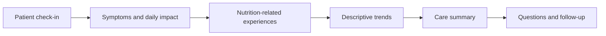
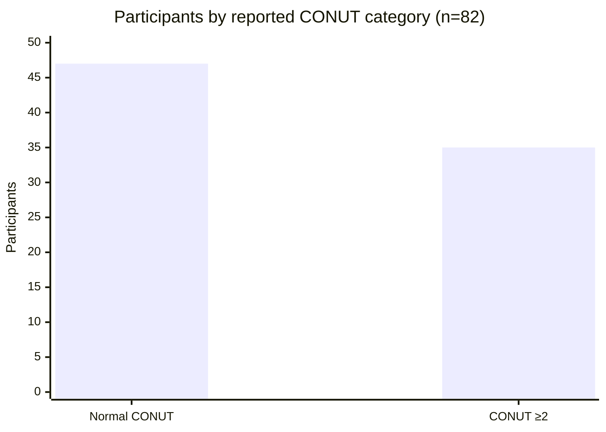

# NOURISH-SSc

### Nutrition, gastrointestinal symptom tracking, and follow-up for systemic sclerosis

**A patient-centered digital health prototype for the NOURISH: Autoimmunity Digital Health Challenge**

[**Open the live prototype**](https://ut1776.github.io/nourish-ssc/) · [View source code](https://github.com/ut1776/nourish-ssc) · [Official NIH NOURISH Digital Health Challenge](https://www.nih.gov/challenges/nourish-autoimmunity-digital-health-challenge)

---

## A milestone in autoimmune digital health innovation

NOURISH-SSc is an independently developed digital health prototype created in alignment with the goals of the National Institutes of Health (NIH) **NOURISH: Autoimmunity Digital Health Challenge**.

The challenge is led by the NIH Office of Autoimmune Disease Research and seeks digital health applications that help people living with or at risk for autoimmune diseases monitor nutrition and dietary changes alongside symptoms. It is a three-phase federal prize competition with **up to $650,000 in total prizes**.

Phase 1 focuses on prototype development. The official submission period runs from October 1, 2026, through January 8, 2027.

For an independent prototype, this creates an opportunity to address a defined problem in autoimmune health: helping people organize nutrition-related experiences, symptom patterns, and questions for clinical follow-up in one practical workflow.

**NOURISH-SSc is an independent project.** Mention of NIH and its challenge identifies the public competition and does not imply NIH sponsorship, selection, funding, approval, or endorsement of this project.

Official source: [NIH — NOURISH: Autoimmunity Digital Health Challenge](https://www.nih.gov/challenges/nourish-autoimmunity-digital-health-challenge)

## The problem

Systemic sclerosis (SSc) is a complex autoimmune connective-tissue disease that can affect multiple organs. Gastrointestinal involvement can contribute to reflux, bloating, difficulty eating, reduced appetite, and other problems that interfere with daily life and nutritional well-being.

These experiences can be difficult to communicate during a short clinical appointment. A patient may remember individual episodes but have difficulty describing how symptoms and nutrition-related changes have varied over time or which concerns still need follow-up.

NOURISH-SSc explores a focused approach to this problem by connecting three activities:

* **Track:** Record symptoms, their impact, and nutrition-related experiences.
* **Review:** Examine descriptive symptom patterns over time.
* **Prepare:** Organize concerns and follow-up items into a care summary.

The prototype is intended to support communication and self-monitoring. It does not diagnose disease, recommend a treatment, or establish that a dietary change caused a symptom change.

## Prototype overview

**Live demonstration:** [ut1776.github.io/nourish-ssc](https://ut1776.github.io/nourish-ssc/)

The current prototype includes:

* Symptom check-ins and saved entries.
* Recording of nutrition-related changes and eating difficulties.
* Descriptive summaries of symptom ratings across recorded entries.
* Follow-up items with status tracking.
* A care summary that brings relevant recorded information and follow-up items together.
* Copy and print options for reviewing or sharing a summary.
* CSV export for further inspection of recorded entries.
* Browser-based local storage for demonstration continuity.

The prototype is designed to demonstrate a workflow, not to claim a clinically validated monitoring system.

## Visual 1 — How NOURISH-SSc works

The workflow brings information together so users can review their experiences and prepare for a clinical conversation. The arrows represent the intended prototype workflow, not a validated clinical decision pathway.

## Visual 2 — Research context: nutritional status in one SSc study

A previously extracted study supplement reported 82 people with systemic sclerosis divided into two CONUT categories.

| Reported category                 | Participants | Percentage of study sample |
| --------------------------------- | -----------: | -------------------------: |
| Normal CONUT category (score 0–1) |           47 |                      57.3% |
| CONUT score ≥2 category           |           35 |                      42.7% |
| **Total**                         |       **82** |                   **100%** |

CONUT is a nutritional screening index based on laboratory measures. The categories above are reproduced from the extracted study table; the score threshold and interpretation should be checked against the original article before formal submission.

### Visual interpretation

**Interpretation:** In this particular study sample, 35 of 82 participants were in the CONUT ≥2 category. This is a descriptive result from one study, not an estimate of prevalence across all people with systemic sclerosis.

**Important evidence distinction:** These are published-study data, not patient data collected by NOURISH-SSc, and they do not demonstrate that the prototype improves nutrition, symptoms, or clinical outcomes.

**Source to verify before submission:** Öz et al. (2025), *Rheumatology International*, 45(1), article 21. DOI: [10.1007/s00296-024-05783-2](https://doi.org/10.1007/s00296-024-05783-2).

## Why this research matters to the prototype

The study provides context for why nutrition-related monitoring deserves attention in systemic sclerosis. Its reported nutritional categories and gastrointestinal symptom measures illustrate the kinds of patient experiences and research outcomes that may be relevant to a monitoring workflow.

NOURISH-SSc takes a narrower implementation step: it helps users organize their own recorded symptoms, nutrition-related experiences, and outstanding concerns.

It does **not** calculate CONUT, diagnose malnutrition, infer an individual's nutritional status from the study, or replace professional nutritional assessment. Any future use of validated measures would require careful implementation, appropriate interpretation, and testing.

## What makes NOURISH-SSc distinctive?

The prototype emphasizes the connection between nutrition-related difficulties and follow-up preparation rather than treating a symptom diary as the entire experience.

| Need                                       | Prototype response                         | Current boundary                                       |
| ------------------------------------------ | ------------------------------------------ | ------------------------------------------------------ |
| Remembering symptom experiences            | Saved check-ins                            | Depends on user-entered information                    |
| Reviewing changes over time                | Descriptive symptom summaries              | Does not establish cause and effect                    |
| Recording eating or nutrition difficulties | Nutrition-related entries                  | Does not prescribe a diet                              |
| Remembering unresolved concerns            | Follow-up items and status                 | Does not send clinical alerts                          |
| Preparing for a clinical conversation      | Care summary with relevant follow-up items | Does not integrate with an electronic health record    |
| Reviewing or exporting information         | Copy, print, and CSV export                | Exported files require appropriate privacy precautions |

The proposed value is the integration of these activities into one simple workflow. Whether this approach is more usable or effective than existing tools remains to be tested.

## Prototype screenshots

Screenshots of the actual working application should be added here before final submission. Capture them directly from the live prototype rather than using generic medical stock images.

Create a folder named `images` in the GitHub repository and upload these files:

1. `images/check-in.png` — a completed fictional symptom check-in.
2. `images/trends.png` — the symptom trend or descriptive summary.
3. `images/care-summary.png` — the care summary with a follow-up item.
4. `images/mobile-view.png` — the application displayed on a narrow mobile screen.

Once uploaded, use these Markdown image embeds:

### Symptom check-in

*Demonstration of the patient-facing check-in. Use fictional data only.*

### Symptom trends

*Descriptive summaries of recorded symptom ratings; not a validated prediction or diagnostic output.*

### Care summary and follow-up

*Example of organizing recorded concerns and follow-up items for review.*

### Mobile presentation

*Mobile-layout demonstration. Verify the actual display before including this image.*

**Do not leave placeholder screenshots in a final submission.** Upload the real screenshots first and verify that all images render correctly in GitHub.

## Scientific rationale and references

The prototype's initial focus is informed by published work on gastrointestinal symptoms, nutritional status, and patient-reported outcomes in systemic sclerosis.

1. Samm et al. (2024). *Journal of Scleroderma and Related Disorders*, 9(3), 216–222. DOI: [10.1177/23971983241264868](https://doi.org/10.1177/23971983241264868).
2. Öz et al. (2025). *Rheumatology International*, 45(1), article 21. DOI: [10.1007/s00296-024-05783-2](https://doi.org/10.1007/s00296-024-05783-2).
3. Khanna et al. (2009). *Arthritis & Rheumatism*, 61(9), 1257–1263. DOI: [10.1002/art.24730](https://doi.org/10.1002/art.24730).

These references provide background for the clinical problem and the relevance of gastrointestinal symptom measurement. Verify each article's title, population, methods, and specific findings against the original publication before attributing a particular claim to it.

The current prototype does not claim to measure immune activity, establish disease progression, or validate a dietary intervention. Future research would need to define suitable outcomes and validated measures for the intended use.

## Development status

| Area                                      | Current status                                             |
| ----------------------------------------- | ---------------------------------------------------------- |
| Working web prototype                     | Available online                                           |
| Symptom check-ins and saved entries       | Implemented                                                |
| Nutrition-related tracking                | Implemented                                                |
| Descriptive symptom summaries             | Implemented                                                |
| Follow-up tracking and care summary       | Implemented                                                |
| Copy, print, and CSV export               | Implemented                                                |
| Formal clinical validation                | Not completed                                              |
| Formal usability study                    | Not completed                                              |
| Documented patient and clinician feedback | Must be reported only after it has actually been collected |
| Electronic health record integration      | Not implemented                                            |
| Secure clinical data infrastructure       | Not implemented                                            |

This status table distinguishes implemented functionality from planned or unvalidated capabilities.

## Next steps

The next development priorities are:

1. **Complete demonstration testing.** Verify check-ins, saved entries, trends, follow-up status, care-summary content, copy/print, and CSV export on the intended device.
2. **Collect end-user feedback where feasible.** Ask people with relevant lived experience and a healthcare professional to review the workflow. Record what they actually reviewed, what they said, and what changed as a result.
3. **Improve the evidence map.** Link each proposed tracked measure to a source, explain why it matters, and distinguish established measures from exploratory self-reported fields.
4. **Review privacy and accessibility.** Test legibility, keyboard and touch interactions, mobile layout, and clear explanations of data handling.
5. **Prepare the Phase 1 narrative and video.** Demonstrate the actual working application and clearly disclose current limitations.

## Privacy and safety limitations

The prototype currently uses browser-based local storage. This is suitable for a limited demonstration, but it is **not secure medical-record storage**. Data may be accessible to someone using the same browser profile and may be lost when browser data is cleared.

* Use fictional demonstration entries.
* Do not enter real patient identifiers or sensitive clinical information.
* Treat exported CSV files and printed summaries as potentially sensitive.
* Do not use the prototype for diagnosis, emergency decisions, or treatment changes.
* No clinical efficacy, safety, or outcome benefit has been established.

Any future real-world or research deployment would require a more complete privacy, security, accessibility, and governance plan.

## AI and development transparency

AI tools may be used in developing challenge submissions under the official challenge rules, provided AI usage is fully disclosed. The final submission should accurately describe which development activities used AI assistance and identify the participant's own contributions to design, implementation, testing, and decision-making.

Do not claim user research, clinical validation, or testing that has not taken place.

## About the project

NOURISH-SSc is an independent prototype exploring how nutrition-related experiences, symptoms, and follow-up preparation can be brought together for people living with systemic sclerosis.

The project is aligned with the public goals of the NIH NOURISH: Autoimmunity Digital Health Challenge, which seeks practical digital health tools to help people monitor nutrition alongside symptoms.

* **Live prototype:** https://ut1776.github.io/nourish-ssc/
* **Source repository:** https://github.com/ut1776/nourish-ssc
* **Official challenge information:** https://www.nih.gov/challenges/nourish-autoimmunity-digital-health-challenge

*Independent project. No NIH or HHS sponsorship, award, selection, approval, or endorsement is claimed.*

---

**Phase 1 reminder:** The official challenge page specifies a submission package including registration, a narrative of no more than six pages with one-inch margins and at least 11-point Calibri, and a 3–5-minute prototype demonstration video. Confirm the current instructions and complete submission process on the official challenge website before submitting.

