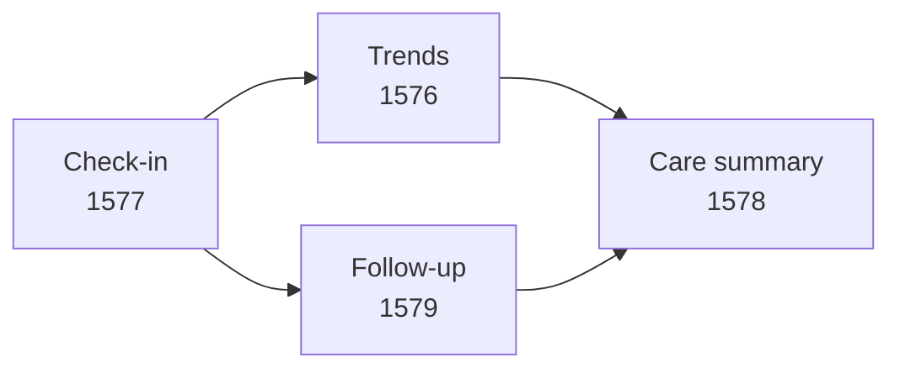

## Working prototype

**[Launch NOURISH-SSc](https://ut1776.github.io/nourish-ssc/)** · **[Browse the source code](https://github.com/ut1776/nourish-ssc)** · **[View all prototype screenshots](https://github.com/ut1776/nourish-ssc/tree/main/screenshots)**

NOURISH-SSc is a functional prototype exploring how people living with systemic sclerosis can organize nutrition-related experiences, symptom patterns, and follow-up concerns in one workflow.

The current application includes symptom check-ins, saved entries, descriptive symptom trends, nutrition-related tracking, follow-up status tracking, a care summary, and copy, print, and CSV export options.

## Screenshots of the actual application

The following screenshots document the current prototype rather than conceptual mockups.

### 1. Symptom trends — Image 1576

The trends view helps users review patterns in their recorded symptom ratings over time. These are descriptive summaries of user-entered information, not diagnostic results or predictions.

### 2. Symptom check-in — Image 1577

The check-in view supports structured recording of symptoms and related experiences. These entries provide the information used in the prototype's summaries.

### 3. Care summary — Image 1578

The care summary brings recorded information together to help users prepare for a clinical conversation. It is a communication aid, not a substitute for professional assessment.

### 4. Follow-up tracking — Image 1579

The follow-up view helps users keep track of recorded concerns and their status, supporting continuity between check-ins and clinical conversations.

### Why these screens matter

Together, these screens demonstrate the prototype's central workflow:

The workflow connects individual symptom entries with descriptive review and follow-up preparation. It is a demonstration of the current application, not evidence that the workflow has improved clinical outcomes.

**Demonstration-data note:** Screenshots should use fictional data only. The application has not been clinically validated, and browser-based local storage is not secure medical-record storage.
