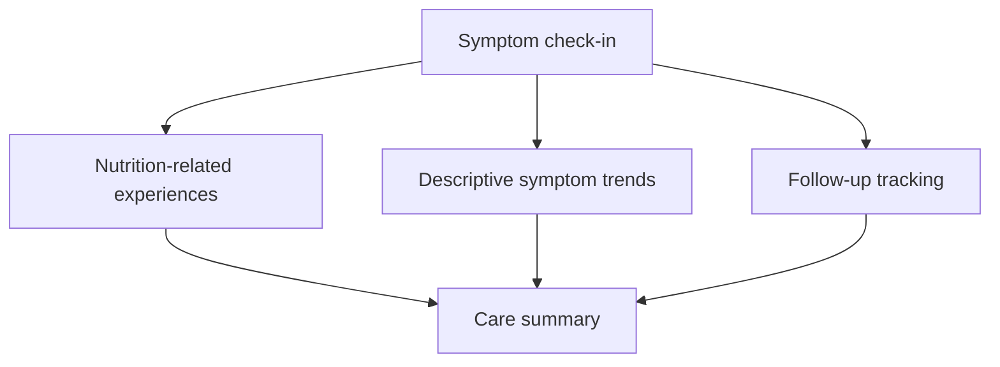
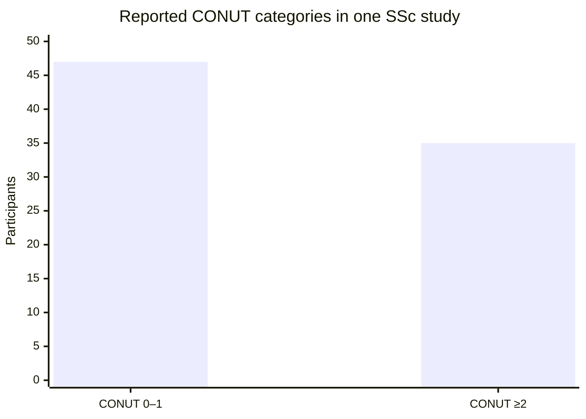

# NOURISH-SSc

### Nutrition, gastrointestinal symptom tracking, and follow-up for systemic sclerosis

**An independent digital health prototype aligned with the NIH NOURISH: Autoimmunity Digital Health Challenge**

[**Launch the live prototype**](https://ut1776.github.io/nourish-ssc/) · [**Source repository**](https://github.com/ut1776/nourish-ssc) · [**Screenshots**](https://github.com/ut1776/nourish-ssc/tree/main/screenshots) · [**Official NIH challenge**](https://www.nih.gov/challenges/nourish-autoimmunity-digital-health-challenge)

---

## 1. A milestone in autoimmune digital health innovation

NOURISH-SSc is an independently developed digital health prototype exploring how nutrition-related difficulties, gastrointestinal symptoms, and follow-up concerns can be organized in one workflow for people living with systemic sclerosis (SSc).

The project aligns with the public goals of the National Institutes of Health (NIH) **NOURISH: Autoimmunity Digital Health Challenge**, led by the NIH Office of Autoimmune Disease Research (OADR).

The official challenge describes a three-phase federal prize competition with up to **$650,000 in total prizes**. The Phase 1 submission period is October 1, 2026, through January 8, 2027.

This project is an independent effort to address a meaningful problem in autoimmune digital health. Mention of the challenge does not imply NIH sponsorship, selection, funding, approval, or endorsement.

Official source: https://www.nih.gov/challenges/nourish-autoimmunity-digital-health-challenge

## 2. The problem

Systemic sclerosis is a complex autoimmune connective-tissue disease that can affect multiple organs. Gastrointestinal involvement may contribute to reflux, bloating, reduced appetite, difficulty eating, and other experiences that affect daily functioning and nutritional well-being.

People may find it difficult to remember symptom patterns, describe nutrition-related changes, and keep track of questions that need follow-up during clinical appointments.

NOURISH-SSc explores a practical workflow connecting three needs:

* **Track:** Record symptoms, their impact, and nutrition-related experiences.
* **Review:** Examine descriptive patterns across saved symptom entries.
* **Prepare:** Organize recorded information and follow-up items for a healthcare conversation.

The prototype supports self-monitoring and communication. It does not diagnose disease, prescribe diets, or establish that dietary changes caused changes in symptoms.

## 3. Working prototype

**Try the application:** https://ut1776.github.io/nourish-ssc/

The current prototype includes:

* Symptom check-ins and saved entries.
* Nutrition-related tracking.
* Descriptive symptom averages and trends.
* Follow-up items with status tracking.
* A care summary incorporating relevant recorded follow-ups.
* Copy and print options.
* CSV export.
* Browser-based local storage for demonstration continuity.

## 4. Screenshots of the actual application

These screenshots are stored in the repository's [`screenshots` folder](https://github.com/ut1776/nourish-ssc/tree/main/screenshots).

### 4.1 Symptom trends — Image 1576

The trends view helps users review descriptive patterns in their recorded symptom ratings. The output reflects the available entries; it is not a diagnostic result or a prediction.

### 4.2 Symptom check-in — Image 1577

The check-in view provides a structured way to record symptoms and related experiences. These entries form the basis of the prototype's descriptive summaries.

### 4.3 Care summary — Image 1578

The care summary brings recorded information together to help users prepare for a clinical conversation. It is a communication aid, not a substitute for professional assessment.

### 4.4 Follow-up tracking — Image 1579

The follow-up view helps users keep track of recorded concerns and their status, supporting continuity between check-ins and clinical conversations.

### How the workflow connects

This diagram represents the intended prototype workflow. It is not a validated clinical decision pathway.

## 5. Scientific context: nutrition in systemic sclerosis

Published research provides a rationale for considering nutritional status and gastrointestinal symptoms in systemic sclerosis.

One previously extracted study supplement reported 82 participants with systemic sclerosis divided into two categories using the Controlling Nutritional Status (CONUT) score.

| Reported category | Participants | Percentage of study sample |
| ----------------- | -----------: | -------------------------: |
| CONUT score 0–1   |           47 |                      57.3% |
| CONUT score ≥2    |           35 |                      42.7% |
| **Total**         |       **82** |                   **100%** |

### Visual summary

**Interpretation:** In this particular study sample, 35 of 82 participants were in the reported CONUT ≥2 category. This is a single-study result, not an estimate of prevalence across all people with systemic sclerosis.

**Source to verify:** Öz et al. (2025), *Rheumatology International*, 45(1), article 21. [DOI: 10.1007/s00296-024-05783-2](https://doi.org/10.1007/s00296-024-05783-2).

Verify the category definitions and figures against the original article and tables before using them in the formal submission. These are published-study data, not data collected by NOURISH-SSc.

The current prototype does not calculate CONUT, diagnose malnutrition, or infer an individual's nutritional status from these study findings.

## 6. What makes NOURISH-SSc distinctive?

The prototype emphasizes the connection between nutrition-related difficulties and follow-up preparation.

| User need                               | Prototype feature           | Current limitation                                  |
| --------------------------------------- | --------------------------- | --------------------------------------------------- |
| Record symptom experiences              | Saved check-ins             | Depends on user-entered information                 |
| Review patterns over time               | Descriptive trends          | Does not establish causation                        |
| Record nutrition-related changes        | Nutrition-related tracking  | Does not prescribe a diet                           |
| Remember unresolved concerns            | Follow-up status tracking   | Does not send clinical alerts                       |
| Prepare for clinical conversations      | Care summary                | Does not integrate with an electronic health record |
| Review or transfer recorded information | Copy, print, and CSV export | Exported files require privacy precautions          |

The potential value is the integration of these activities into one workflow. Whether this approach improves usability, communication, or health outcomes remains to be evaluated.

## 7. Development status

| Component                            | Status           |
| ------------------------------------ | ---------------- |
| Functional web prototype             | Available online |
| Symptom check-ins and saved entries  | Implemented      |
| Nutrition-related tracking           | Implemented      |
| Descriptive symptom summaries        | Implemented      |
| Follow-up tracking                   | Implemented      |
| Care summary                         | Implemented      |
| Copy, print, and CSV export          | Implemented      |
| Formal clinical validation           | Not completed    |
| Formal usability study               | Not completed    |
| Electronic health record integration | Not implemented  |
| Secure clinical data infrastructure  | Not implemented  |

Patient or healthcare-professional feedback should be reported only after it has actually been collected. Future testing should examine usability, clarity, accessibility, and whether the workflow supports the intended communication tasks.

## 8. Next steps

1. **Verify functionality:** Test check-ins, saved entries, trends, follow-up status, care-summary content, copy/print, and CSV export.
2. **Seek appropriate feedback:** Where feasible, ask people with relevant lived experience and a healthcare professional to review the workflow and document their actual feedback.
3. **Strengthen the evidence map:** Link proposed measures to reliable sources and distinguish established measures from exploratory fields.
4. **Review privacy and accessibility:** Test mobile presentation, legibility, touch interactions, and safe handling of exported information.
5. **Prepare the submission:** Complete the narrative and a concise video demonstrating the actual application and its limitations.

## 9. Privacy, safety, and limitations

The prototype currently uses browser-based local storage. This supports demonstration continuity but is **not secure medical-record storage**. Data may be accessible to others using the same browser profile and may be lost if browser data is cleared.

* Use fictional demonstration data.
* Do not enter real patient identifiers or sensitive clinical information.
* Treat exported CSV files and printed summaries as potentially sensitive.
* Do not use the prototype for diagnosis, emergency decisions, or treatment changes.
* No clinical efficacy, safety, or health-outcome benefit has been established.

Any future real-world deployment would require a more complete privacy, security, accessibility, and governance plan.

## 10. Scientific references

The following publications provide background for the clinical problem and the relevance of gastrointestinal symptom measurement. Verify each article's title, population, methods, and specific findings against the original publication before attributing claims to it.

1. Samm et al. (2024). *Journal of Scleroderma and Related Disorders*, 9(3), 216–222. [DOI: 10.1177/23971983241264868](https://doi.org/10.1177/23971983241264868).
2. Öz et al. (2025). *Rheumatology International*, 45(1), article 21. [DOI: 10.1007/s00296-024-05783-2](https://doi.org/10.1007/s00296-024-05783-2).
3. Khanna et al. (2009). *Arthritis & Rheumatism*, 61(9), 1257–1263. [DOI: 10.1002/art.24730](https://doi.org/10.1002/art.24730).

These references provide scientific context; their inclusion does not establish that the prototype is validated or that its use improves outcomes.

## 11. AI and development transparency

AI tools may be used in developing competition submissions only in accordance with the official challenge rules and disclosure requirements.

The final submission should accurately describe which development activities used AI assistance and identify the participant's own contributions to design, implementation, testing, and decision-making. Do not claim testing, feedback, clinical validation, or outcomes that have not occurred.

## About this project

NOURISH-SSc is an independent prototype exploring how nutrition-related experiences, symptoms, and follow-up preparation can be brought together for people living with systemic sclerosis.

* **Live prototype:** https://ut1776.github.io/nourish-ssc/
* **Source repository:** https://github.com/ut1776/nourish-ssc
* **Screenshots:** https://github.com/ut1776/nourish-ssc/tree/main/screenshots
* **Official NIH challenge:** https://www.nih.gov/challenges/nourish-autoimmunity-digital-health-challenge

*Independent project. No NIH or HHS sponsorship, award, selection, approval, or endorsement is claimed.*

---

**Phase 1 reminder:** Consult the [official challenge website](https://www.nih.gov/challenges/nourish-autoimmunity-digital-health-challenge) for current submission requirements, including the narrative, registration, formatting, and prototype demonstration video.
