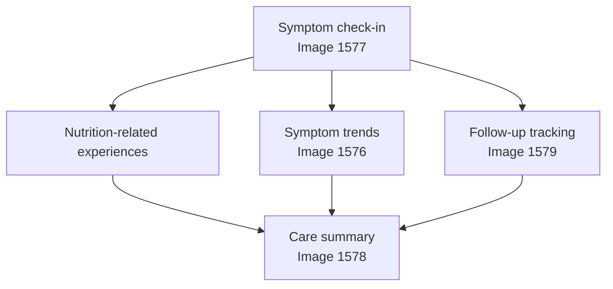
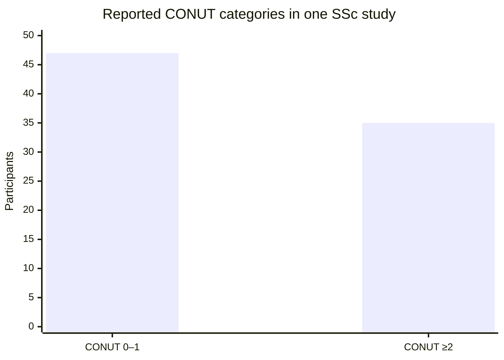

# NOURISH-SSc

### Nutrition, gastrointestinal symptom tracking, and follow-up for systemic sclerosis

**An independent digital health prototype aligned with the NIH NOURISH: Autoimmunity Digital Health Challenge**

[**Launch the live prototype**](https://ut1776.github.io/nourish-ssc/) · [**View source code**](https://github.com/ut1776/nourish-ssc) · [**View screenshots**](https://github.com/ut1776/nourish-ssc/tree/main/screenshots) · [**Official NIH challenge**](https://www.nih.gov/challenges/nourish-autoimmunity-digital-health-challenge)

---

## 1. Why this project matters

NOURISH-SSc explores a practical digital health problem: how people living with systemic sclerosis can organize nutrition-related difficulties, gastrointestinal symptoms, and follow-up concerns in a single workflow.

Systemic sclerosis (SSc) is a complex autoimmune connective-tissue disease that can affect multiple organs. Gastrointestinal involvement may contribute to reflux, bloating, difficulty eating, reduced appetite, and other experiences that affect daily life and nutritional well-being.

People may find it difficult to remember symptom patterns, describe nutrition-related changes, and communicate outstanding concerns during a short clinical appointment. NOURISH-SSc is designed to help organize that information for review and discussion.

### Connection to the NIH NOURISH challenge

The National Institutes of Health (NIH) Office of Autoimmune Disease Research (OADR) runs the **NOURISH: Autoimmunity Digital Health Challenge**, a three-phase federal prize competition focused on digital health approaches to nutrition and autoimmune disease.

The official challenge describes a total prize pool of up to **$650,000**. The Phase 1 submission period is October 1, 2026, through January 8, 2027.

This project is an independent prototype developed in alignment with the challenge's public goals. Participation in the competition does not imply selection, funding, an award, or endorsement by NIH or any federal agency.

Official information: https://www.nih.gov/challenges/nourish-autoimmunity-digital-health-challenge

## 2. The problem NOURISH-SSc addresses

The prototype focuses on three connected needs:

* **Nutrition-related experiences:** Record eating difficulties and relevant changes alongside symptoms.
* **Symptom awareness:** Review descriptive patterns in recorded symptom ratings over time.
* **Follow-up preparation:** Organize concerns and follow-up items to support conversations with healthcare professionals.

The central idea is to connect symptom tracking with nutrition-related experiences and follow-up preparation, rather than treating a symptom diary as the entire patient experience.

## 3. Working prototype

**Try it:** https://ut1776.github.io/nourish-ssc/

The current web prototype includes:

* Symptom check-ins and saved entries.
* Nutrition-related tracking.
* Descriptive symptom averages and trends.
* Follow-up items with status tracking.
* A care summary that incorporates relevant recorded follow-ups.
* Copy and print options.
* CSV export.
* Browser-based local storage for demonstration continuity.

The application is intended to support self-monitoring and communication. It does not diagnose disease, prescribe dietary interventions, predict disease progression, or replace professional assessment.

## 4. Screenshots of the actual application

These screenshots document the current prototype. They are stored in the repository's [`screenshots`](https://github.com/ut1776/nourish-ssc/tree/main/screenshots) folder.

### 4.1 Symptom trends — Image 1576

The trends view helps users review descriptive patterns in their recorded symptom ratings. The output reflects the available entries; it is not a diagnostic result or a prediction.

### 4.2 Symptom check-in — Image 1577

The check-in view provides a structured way to record symptoms and related experiences. These entries form the basis of the prototype's descriptive summaries.

### 4.3 Care summary — Image 1578

The care summary brings recorded information together to help users prepare for a clinical conversation. It is a communication aid, not a substitute for professional assessment.

### 4.4 Follow-up tracking — Image 1579

The follow-up view helps users keep track of recorded concerns and their status, supporting continuity between symptom check-ins and clinical conversations.

### How the screens work together

This diagram describes the intended prototype workflow. It is not evidence of clinical effectiveness or a validated clinical decision pathway.

## 5. Scientific context: nutrition in systemic sclerosis

Published research provides a rationale for considering nutritional status and gastrointestinal symptoms in systemic sclerosis.

One previously extracted study supplement reported 82 participants with systemic sclerosis divided into two categories using the Controlling Nutritional Status (CONUT) score.

| Reported category | Participants | Percentage of this study sample |
| ----------------- | -----------: | ------------------------------: |
| CONUT score 0–1   |           47 |                           57.3% |
| CONUT score ≥2    |           35 |                           42.7% |
| **Total**         |       **82** |                        **100%** |

### Visual summary of the study sample

**Interpretation:** In this particular sample, 35 of 82 participants were in the reported CONUT ≥2 category. This is a result from one study, not an estimate of prevalence across all people with systemic sclerosis.

**Source for verification:** Öz et al. (2025), *Rheumatology International*, 45(1), article 21. DOI: https://doi.org/10.1007/s00296-024-05783-2

The category definitions and values should be checked against the original publication and its tables before formal submission. The study data are not data collected by NOURISH-SSc.

### How the evidence informs the prototype

The published findings provide context for the importance of nutritional assessment in systemic sclerosis. NOURISH-SSc explores a different, more limited question: can a simple workflow help people organize nutrition-related experiences, symptom patterns, and questions for follow-up?

The current prototype does not calculate CONUT, diagnose malnutrition, infer an individual's nutritional status from research data, or determine whether a dietary change caused a symptom change.

## 6. What makes the approach distinctive?

NOURISH-SSc emphasizes the connection between nutrition-related difficulties and follow-up preparation.

| User need                               | Prototype feature           | Current limitation                                  |
| --------------------------------------- | --------------------------- | --------------------------------------------------- |
| Record symptom experiences              | Saved check-ins             | Depends on user-entered information                 |
| Review patterns over time               | Descriptive trends          | Does not establish causation                        |
| Record nutrition-related changes        | Nutrition-related tracking  | Does not prescribe a diet                           |
| Remember unresolved concerns            | Follow-up status tracking   | Does not send clinical alerts                       |
| Prepare for a healthcare conversation   | Care summary                | Does not integrate with an electronic health record |
| Review or transfer recorded information | Copy, print, and CSV export | Exported files require privacy precautions          |

The potential value is the integration of these functions into one workflow. Whether this approach improves usability, communication, or health outcomes remains to be evaluated.

## 7. Development status

| Component                            | Status           |
| ------------------------------------ | ---------------- |
| Functional web prototype             | Available online |
| Symptom check-ins and saved entries  | Implemented      |
| Nutrition-related tracking           | Implemented      |
| Descriptive symptom summaries        | Implemented      |
| Follow-up tracking                   | Implemented      |
| Care summary                         | Implemented      |
| Copy, print, and CSV export          | Implemented      |
| Formal clinical validation           | Not completed    |
| Formal usability study               | Not completed    |
| Electronic health record integration | Not implemented  |
| Secure clinical data infrastructure  | Not implemented  |

Any patient or healthcare-professional feedback should be reported only after it has actually been collected. Future testing should assess usability, clarity, accessibility, and whether the workflow supports the intended communication tasks.

## 8. Next steps

1. **Verify the prototype.** Test check-ins, saved entries, trends, follow-up status, care-summary content, and exports.
2. **Review the experience with intended users.** Where feasible, gather feedback from people with relevant lived experience and a healthcare professional, documenting what they reviewed and what changed.
3. **Strengthen the evidence map.** Connect each proposed measure to a reliable source and distinguish established measures from exploratory fields.
4. **Improve accessibility and privacy.** Review mobile usability, legibility, data handling, and safe use of exported information.
5. **Prepare the competition submission.** Complete the narrative and a concise video demonstration showing the actual application and its limitations.

## 9. Privacy, safety, and limitations

The prototype currently uses browser-based local storage. This supports demonstration continuity but is **not secure medical-record storage**. Data may be accessible to other people using the same browser profile and may be lost if browser data is cleared.

* Use fictional demonstration data.
* Do not enter real patient identifiers or sensitive clinical information.
* Treat exported CSV files and printed summaries as potentially sensitive.
* Do not use the application for diagnosis, emergency decisions, or treatment changes.
* No clinical efficacy, safety, or health-outcome benefit has been established.

Any future real-world deployment would require a more complete privacy, security, accessibility, and governance plan.

## 10. Scientific references

The following publications provide background for the clinical problem and the relevance of gastrointestinal symptom measurement. Verify each article's title, population, methods, and specific findings against the original publication before attributing claims to it.

1. Samm et al. (2024). *Journal of Scleroderma and Related Disorders*, 9(3), 216–222. DOI: https://doi.org/10.1177/23971983241264868
2. Öz et al. (2025). *Rheumatology International*, 45(1), article 21. DOI: https://doi.org/10.1007/s00296-024-05783-2
3. Khanna et al. (2009). *Arthritis & Rheumatism*, 61(9), 1257–1263. DOI: https://doi.org/10.1002/art.24730

These references provide scientific context; their inclusion does not establish that the prototype is validated or that its use improves outcomes.

## 11. AI and development transparency

AI tools may be used in developing competition submissions only in accordance with the official challenge rules and disclosure requirements.

The final submission should accurately describe which development activities used AI assistance and identify the participant's own contributions to design, implementation, testing, and decision-making. Do not claim testing, user feedback, clinical validation, or outcomes that have not occurred.

## About this project

NOURISH-SSc is an independent prototype exploring how nutrition-related experiences, symptoms, and follow-up preparation can be brought together for people living with systemic sclerosis.

* **Live prototype:** https://ut1776.github.io/nourish-ssc/
* **Source repository:** https://github.com/ut1776/nourish-ssc
* **Screenshots:** https://github.com/ut1776/nourish-ssc/tree/main/screenshots
* **Official NIH challenge:** https://www.nih.gov/challenges/nourish-autoimmunity-digital-health-challenge

*Independent project. No NIH or HHS sponsorship, award, selection, approval, or endorsement is claimed.*

---

**Phase 1 reminder:** Check the official challenge page for the current submission requirements, including the narrative page limit and formatting, registration, and prototype demonstration video requirements.
